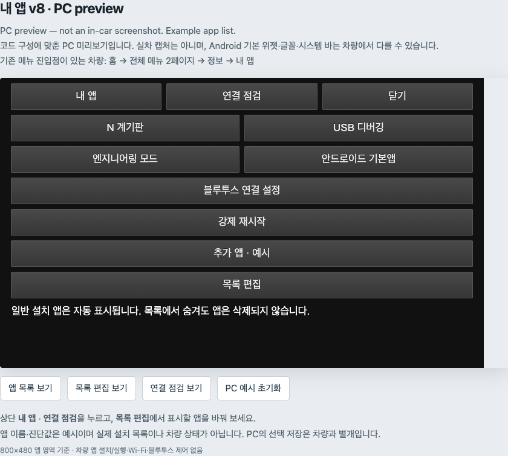

# Veloster N Dashboard

**English** | [한국어](README_ko.md)

A standalone Android dashboard for the Veloster N factory head unit, with a companion **My Apps** launcher. It installs as a separate package without replacing the factory N Mode APK. Project-authored code and documentation are available under the [MIT License](LICENSE).

**Tested target:** Korean JSN head unit, Android API 17, build `eng.vmadmin.20250902.081552`. Compatibility with other model years, regions, newer N vehicles, or ordinary Android devices is not established. Perform installation and screen interaction while parked.

## In the car


Actual owner-provided photo of the overview screen on the factory head unit. Unavailable readings remain marked with a dash. Location and camera metadata have been removed; the image pixels are unchanged.

[Open the full-resolution photo](docs/images/dashboard-overview-in-car.jpg)

## Download

[Download the complete v2026.10.26 installation ZIP](https://github.com/reikop/veloster-n-dashboard/releases/download/v2026.10.26/veloster-n-dashboard-v2026.10.26.zip) — includes both apps, the installer and guides. **Prerelease: v9 vehicle/reboot testing is still pending.**

| APK | Purpose | Verification scope |
| --- | --- | --- |
| [N Dashboard v5](apks/N-Dashboard-v5-API17.apk) | Current dashboard | Installed on the target vehicle; initial telemetry display verified |
| [My Apps v9 — prerelease](apks/My-Apps-v9-API17.apk) | Opt-in floating/notification shortcut, app list, head-unit controls | Signed and host-checked; not yet tested on a vehicle or emulator |
| [My Apps v8](apks/My-Apps-v8-API17.apk) | Historical app without the new shortcut | Previously installed on the target vehicle; not the current source version |
| [N Dashboard v3](apks/rollback/N-Dashboard-v3-API17.apk) | Previous release for recovery | Previously tested; downgrade and data retention require care |

Download the complete latest repository or the `v2026.10.26` release bundle on your computer and follow the [installation guide](docs/INSTALL_EN.md). The original `v2026.10.23` ZIP remains unchanged and does not include the new tooling. **A working ADB connection is required for initial installation.** Copying an APK to an SD card does not install it. Check file integrity before proceeding:

```sh
python3 scripts/verify_release.py
```

Package identities, versions, sizes, and SHA-256 hashes are recorded in [release.json](release.json) and [SHA256SUMS](SHA256SUMS). The bundled APKs are signed; the source builder produces unsigned APKs. The public AOSP test certificate used by these releases is not a private publisher identity or an OTA signing key. See [NOTICE.md (Korean)](NOTICE.md).

## Install, then make it reachable

1. Establish [ADB access](docs/ADB_EN.md) while parked and run the guarded [installer](docs/INSTALL_EN.md). It creates a fresh backup, installs/readback-verifies both apps, and requests opening My Apps. No source compilation is needed.
2. In the opened My Apps screen, choose **실행 바로가기 / Quick entry → Floating + notification → Save**.
3. Return to HOME and tap the small edge button to reopen My Apps, then **N 계기판**. Verify this on your screen before disconnecting.
4. If overlays are blocked, the service retains a notification. If your factory UI cannot expose that notification either, use an existing launcher or the **optional, build-specific [OEM menu procedure](docs/MENU_ENTRY.md)**.

From the complete project directory, using your actual serial from `adb devices -l`:

```sh
python3 scripts/install.py --serial YOUR_DEVICE_SERIAL --parked
```

Use `--check` instead of `--parked` for inspection/backups without installing or launching. An accepted launch request is not a completed screen check. Verify HOME → edge button → My Apps → N Dashboard before disconnecting; separately check reopening after a normal full reboot while parked.

The new shortcut uses standard Android facilities without modifying OEM menus. It defaults to OFF and must be enabled explicitly. A general design does **not** establish compatibility with every head unit; v9 is an untested-on-vehicle prerelease. [Quick-entry setup and limitations](docs/QUICK_ENTRY.md)

## Features

- F1 dashboard with compact album artwork; tap the artwork to toggle media controls, including previous, next, and play/pause.
- A 20-card overview, per-card number/bar/arc display options, editable 6-slot or 12-slot gauges, graphs, and a clock. Display settings persist locally.
- RPM, speed, temperatures, throttle, brake, steering, and other available vehicle data. Four TPMS pressures share one card; they are not tire temperatures.
- Additional v5 decoding for intake temperature, battery voltage/SOC, steering speed, TCS/ESC/ABS state, and wheel speeds from an existing head-unit data stream. Missing data is not fabricated.
- My Apps v9: opt-in movable edge button and notification for reopening the app, dashboard shortcut, editable app list, engineering mode shortcut, USB debugging controls, Android utilities, Classic Bluetooth discovery/pairing, and restart with confirmation.

Vehicle telemetry uses existing receive paths without issuing new ECU diagnostic requests. Media controls and explicit settings actions in My Apps do change playback or device state.

## My Apps companion

My Apps opens N Dashboard, other installed apps, and available head-unit settings. It provides an editable app list, USB debugging controls, engineering and Android utilities shortcuts, Classic Bluetooth pairing, and a restart confirmation dialog. It does not replace the factory home screen or add an OEM entry point automatically.



*Historical v8 layout preview; v9 adds Quick entry above these controls. This image is not the current v9 screen or an Android/in-car capture.*

[My Apps guide and screenshots](docs/MY_APPS.md) · [한국어 설명](docs/MY_APPS_ko.md). The guide also includes list editing, restart confirmation, and a clearly labelled earlier real vehicle screenshot.

## Important limitations

- **The factory home screen may not show newly installed apps.** Configure and verify the v9 quick-entry button/notification after the first ADB launch. OEM menus are not changed by this feature. If neither shortcut is accessible, an alternative entry is still required.
- The dashboard requires the OEM `automotive` library. Its additional HSCAN receiver only connects on the exact product/build listed above.
- Readings expire 60 seconds after the last received update. Repeated reception of an unchanged value refreshes that timer; sensor-level freshness cannot always be determined.
- Exhaust temperature and e-LSD values remain unverified. Wireless CarPlay, GPS track timing, and automatic updates are not implemented. My Apps retains an experimental hotspot screen; this does not provide wireless CarPlay.
- Initial operation has been checked, but cold boot, extended operation, and actual ABS/TCS/ESC intervention transitions are not fully validated.

## Launching after disconnecting or rebooting

Once installed, the dashboard reads vehicle data inside the head unit; a PC or USB debugging connection is not required for normal use. Unplugging the cable does not uninstall the app. After a reboot, the enabled v9 shortcut service requests restoration of the button/notification; it does not automatically open a full-screen app. Tap the available shortcut to open My Apps and the dashboard. Force-stop or device policy can block restoration; v9 boot behavior has not been vehicle-validated.

On our research vehicle, with its separately configured OEM menu entry, the route is **HOME → All menus → page 2 → Information (정보) → My Apps (내 앱) → N Dashboard (N 계기판)**. That menu route was checked during prior vehicle work; v5 cold-boot operation remains unverified. A compatible launcher can also open N Dashboard directly.

**The public APKs do not create the OEM Information/My Apps entry.** That path is optional when the v9 shortcut works. If no entry is available, reconnect ADB; reinstalling the same APK does not add a home icon. See the [disconnect/reboot procedure and ADB fallback](docs/INSTALL_EN.md#after-reboot).

## How this project started

We started from the Veloster N BlueLink update package and used open-source tooling to investigate the firmware catalog, Android apps, and vehicle data paths. [Read the download and research walkthrough](docs/RESEARCH.md) for `nudl` commands, the exact model/version and package hashes, extraction stages, ADB findings, and the move to a standalone app. [한국어 과정 설명](docs/RESEARCH_ko.md)

## Documentation

The main installation and entry guides are available in English and Korean. The research walkthrough is also [English](docs/RESEARCH.md) / [한국어](docs/RESEARCH_ko.md).

- [ADB access and USB troubleshooting](docs/ADB_EN.md): menu entry, command format, cable limitations, and evidence scope. Includes analyzed password candidates for device calendar years 2026 and 2027.
- [Installation, launch, and recovery](docs/INSTALL_EN.md): backups, signature errors, home-screen limitations, and removal.
- [Quick entry](docs/QUICK_ENTRY.md), [optional OEM menu entry](docs/MENU_ENTRY.md), and [installation audit](docs/INSTALL_AUDIT.md).
- [Compatibility and limitations (Korean)](docs/LIMITATIONS.md): telemetry interpretation, missing features, SD updates, and signing.
- [Building and testing (Korean)](docs/BUILD.md): external SDK tools, unsigned builds, and synthetic host tests.
- [Release provenance and verification (Korean)](docs/RELEASE.md), [license and dependency notice](NOTICE.md).

## Source and tests

| Directory | Contents |
| --- | --- |
| `apps/` | Dashboard and My Apps sources and manifests |
| `shared/` | Dashboard UI, telemetry, media, and shared utility code |
| `compile-stubs/` | Minimal OEM API declarations for compilation only; excluded from APKs |
| `tests/` | Synthetic host tests; no private vehicle logs required |
| `scripts/` | Build/test/integrity tools and guarded ADB installation/menu operations |
| `apks/` | Signed installable releases and the previous dashboard APK |

Run host tests with Python 3.9+ and JDK 17:

```sh
python3 scripts/test.py --java /path/to/jdk17/bin/java
```

To build, supply your own Android API 16/17 `android.jar`, AAPT2, and R8/D8 tools. Replace the paths below with your local paths:

```sh
python3 scripts/build.py dashboard \
  --java /path/to/jdk17/bin/java \
  --android-jar /path/to/android.jar \
  --aapt2 /path/to/aapt2 \
  --r8-jar /path/to/r8.jar \
  --out build/dashboard
```

Use `hub` instead of `dashboard` and a different output directory for My Apps. Builds are unsigned and not installable as-is. API 17-compatible signing and acceptance by the target head unit require separate verification; no private keys are distributed. Byte-for-byte reproduction of the bundled APKs is not promised.

OEM firmware, extracted APKs/ODEX, decompiled vendor implementations, private vehicle logs, device identifiers, signing private keys, and third-party apps are excluded. This is an unofficial project with no manufacturer affiliation.
