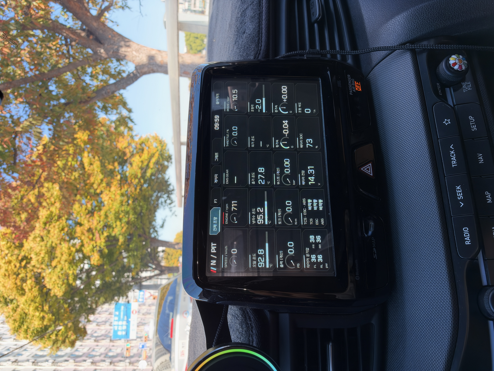

# Veloster N Dashboard

**English** | [한국어](README_ko.md)

A standalone Android dashboard for the Veloster N factory head unit, with a companion **My Apps** launcher. It installs as a separate package without replacing the factory N Mode APK. Project-authored code and documentation are available under the [MIT License](LICENSE).

**Tested target:** Korean JSN head unit, Android API 17, build `eng.vmadmin.20250902.081552`. Compatibility with other model years, regions, newer N vehicles, or ordinary Android devices is not established. Perform installation and screen interaction while parked.

## In the car



Actual owner-provided photo of the overview screen on the factory head unit. Unavailable readings remain marked with a dash. Location and camera metadata have been removed; the image pixels are unchanged.

[Open the full-resolution photo](docs/images/dashboard-overview-in-car.jpg)

## Download

| APK | Purpose | Verification scope |
| --- | --- | --- |
| [N Dashboard v5](apks/N-Dashboard-v5-API17.apk) | Current dashboard | Installed on the target vehicle; initial telemetry display verified |
| [My Apps v8](apks/My-Apps-v8-API17.apk) | Dashboard shortcut, app list, USB debugging controls | Previously installed on the target vehicle |
| [N Dashboard v3](apks/rollback/N-Dashboard-v3-API17.apk) | Previous release for recovery | Previously tested; downgrade and data retention require care |

Download the files on your computer and follow the [installation guide (Korean)](docs/INSTALL.md). **A working ADB connection is required for initial installation.** Copying an APK to an SD card does not install it. Check file integrity before proceeding:

```sh
python3 scripts/verify_release.py
```

Package identities, versions, sizes, and SHA-256 hashes are recorded in [release.json](release.json) and [SHA256SUMS](SHA256SUMS). The bundled APKs are signed; the source builder produces unsigned APKs. The public AOSP test certificate used by these releases is not a private publisher identity or an OTA signing key. See [NOTICE.md (Korean)](NOTICE.md).

## Features

- F1 dashboard with compact album artwork; tap the artwork to toggle media controls, including previous, next, and play/pause.
- A 20-card overview, per-card number/bar/arc display options, editable 6-slot or 12-slot gauges, graphs, and a clock. Display settings persist locally.
- RPM, speed, temperatures, throttle, brake, steering, and other available vehicle data. Four TPMS pressures share one card; they are not tire temperatures.
- Additional v5 decoding for intake temperature, battery voltage/SOC, steering speed, TCS/ESC/ABS state, and wheel speeds from an existing head-unit data stream. Missing data is not fabricated.
- My Apps: dashboard shortcut, editable app list, engineering mode shortcut, USB debugging controls, Android utilities, Classic Bluetooth discovery/pairing, and restart with confirmation.

Vehicle telemetry uses existing receive paths without issuing new ECU diagnostic requests. Media controls and explicit settings actions in My Apps do change playback or device state.

## Important limitations

- **The factory home screen may not show newly installed apps.** This release does not include a modified OEM home APK. Initial launch uses ADB; launching again without a computer requires a working launcher or app entry point on your head unit.
- The dashboard requires the OEM `automotive` library. Its additional HSCAN receiver only connects on the exact product/build listed above.
- Readings expire 60 seconds after the last received update. Repeated reception of an unchanged value refreshes that timer; sensor-level freshness cannot always be determined.
- Exhaust temperature and e-LSD values remain unverified. Wireless CarPlay, GPS track timing, and automatic updates are not implemented. My Apps retains an experimental hotspot screen; this does not provide wireless CarPlay.
- Initial operation has been checked, but cold boot, extended operation, and actual ABS/TCS/ESC intervention transitions are not fully validated.

## How this project started

We started from the Veloster N BlueLink update package and used open-source tooling to investigate the firmware catalog, Android apps, and vehicle data paths. [Read the download and research walkthrough](docs/RESEARCH.md) for `nudl` commands, the exact model/version and package hashes, extraction stages, ADB findings, and the move to a standalone app. [한국어 과정 설명](docs/RESEARCH_ko.md)

## Documentation

The [download and research walkthrough](docs/RESEARCH.md) is available in English and [Korean](docs/RESEARCH_ko.md). The detailed operational guides below are currently in Korean:

- [ADB access and USB troubleshooting](docs/ADB.md): menu entry, command format, cable limitations, and evidence scope. Includes analyzed password candidates for device calendar years 2026 and 2027.
- [Installation, launch, and recovery](docs/INSTALL.md): backups, signature errors, home-screen limitations, and removal.
- [Compatibility and limitations](docs/LIMITATIONS.md): telemetry interpretation, missing features, SD updates, and signing.
- [Building and testing](docs/BUILD.md): external SDK tools, unsigned builds, and synthetic host tests.
- [Release provenance and verification](docs/RELEASE.md), [license and dependency notice](NOTICE.md).

## Source and tests

| Directory | Contents |
| --- | --- |
| `apps/` | Dashboard and My Apps sources and manifests |
| `shared/` | Dashboard UI, telemetry, media, and shared utility code |
| `compile-stubs/` | Minimal OEM API declarations for compilation only; excluded from APKs |
| `tests/` | Synthetic host tests; no private vehicle logs required |
| `scripts/` | Offline build, test, and integrity-check tools |
| `apks/` | Signed installable releases and the previous dashboard APK |

Run host tests with Python 3.9+ and JDK 17:

```sh
python3 scripts/test.py --java /path/to/jdk17/bin/java
```

To build, supply your own Android API 16/17 `android.jar`, AAPT2, and R8/D8 tools. Replace the paths below with your local paths:

```sh
python3 scripts/build.py dashboard \
  --java /path/to/jdk17/bin/java \
  --android-jar /path/to/android.jar \
  --aapt2 /path/to/aapt2 \
  --r8-jar /path/to/r8.jar \
  --out build/dashboard
```

Use `hub` instead of `dashboard` and a different output directory for My Apps. Builds are unsigned and not installable as-is. API 17-compatible signing and acceptance by the target head unit require separate verification; no private keys are distributed. Byte-for-byte reproduction of the bundled APKs is not promised.

OEM firmware, extracted APKs/ODEX, decompiled vendor implementations, private vehicle logs, device identifiers, signing private keys, and third-party apps are excluded. This is an unofficial project with no manufacturer affiliation.
