# Veloster N Dashboard

**English** | [한국어](README_ko.md)

A standalone dashboard for the Veloster N factory head unit, with **My Apps** for opening your dashboard and installed apps. Korean and English included. Installs alongside factory N Mode.

[Install](#install) · [Compatibility & status](docs/STATUS.md) · [Documentation](docs/README.md)

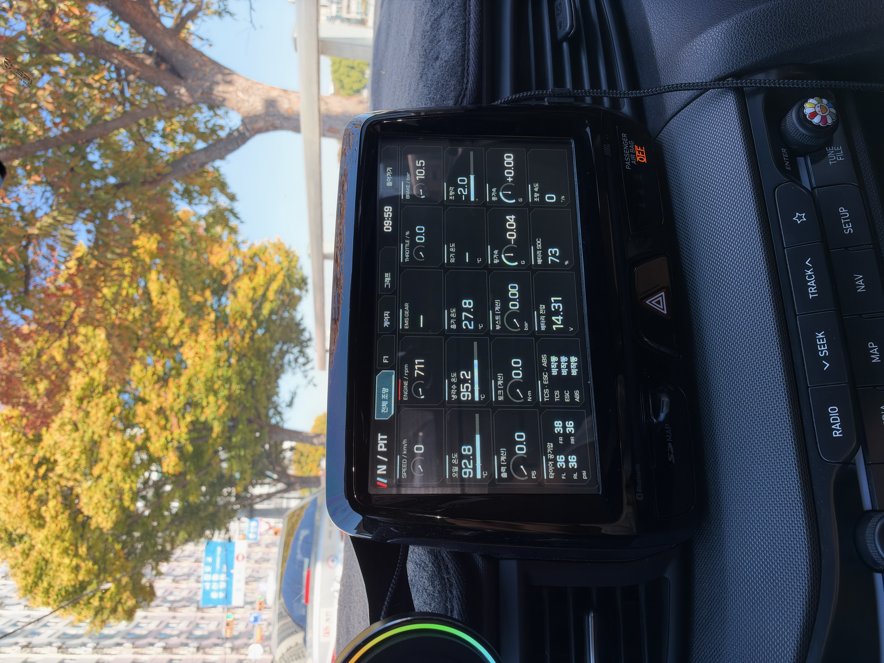

Owner-provided in-car photo. Missing readings display a dash. Location/camera metadata has been removed; image pixels are unchanged.

## Features

| N Dashboard | My Apps |
| --- | --- |
| 21 screens: overview, F1, gauges, graphs, performance, taxi meter, records, race, Λ, tacho, Neon Drive, night, VFD, HUD, G circle, warp, drag, cassette, show, circuit (lap timer at six Korean tracks), My Car (3D Veloster N with live lamps and steering) | Dashboard and installed-app launcher |
| Screen list (show/hide/order), 20 themes, hold-to-change tiles, drive-mode colours and screens | Opt-in edge button and notification shortcut |
| Floating window over other apps, settings backup, records room (best runs kept), [system font changer](docs/FONTS.md) | Engineering mode, USB debugging and Android utilities |
| Taxi meter with 17 regional fares picked from GPS; engine sound, shift beep, speed chime | Bluetooth pairing and restart confirmation |
| RPM, speed, temperatures, TPMS, TCS/ESC/ABS; media controls and artwork | Editable app list and Korean/English selection |

Floating window, settings backup, records room, themes, screen list, race/Λ/tacho screens, sounds, regional taxi fares and the owner installers are adapted from the i30 PD port [sung9155/i30-pd-dashboard](https://github.com/sung9155/i30-pd-dashboard) (MIT). Owner install guide: [INSTALL.md](INSTALL.md).

Vehicle telemetry uses existing receive paths without adding ECU diagnostic requests. Missing or expired readings stay unknown. Bluetooth album-art reception, exhaust temperature and e-LSD remain unresolved. Wireless CarPlay and automatic updates are not provided. [Full limitations](docs/LIMITATIONS.md)

## Screens

All 21 tabs. Show, hide or reorder them by holding the tab strip or in Settings → Screens. These are **screenshots of the real dashboard app on an Android emulator (800×480)**. The emulator has no car data, so a screenshot-only build replays one minute of synthetic driving. They are not photos of the car, and the text uses Android's default font rather than the head unit's. Neon Drive runs its demo without car signals, the circuit screen's GPS wait is how the current app behaves, and My Car's headlamps were switched on with its test buttons. Retake with `scripts/emulator_screens.py`.

<table>
<tr><td width="50%" valign="top">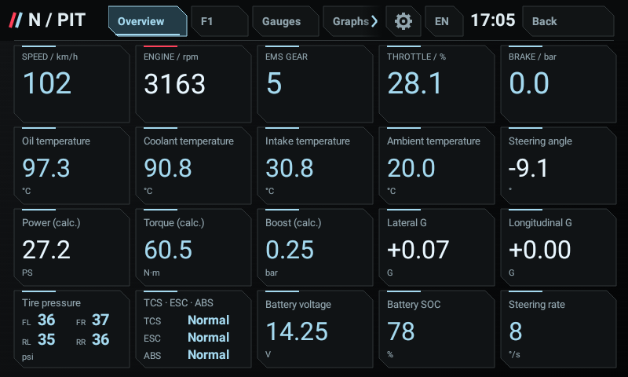<br><b>1. Overview</b> · Every value at a glance</td><td width="50%" valign="top">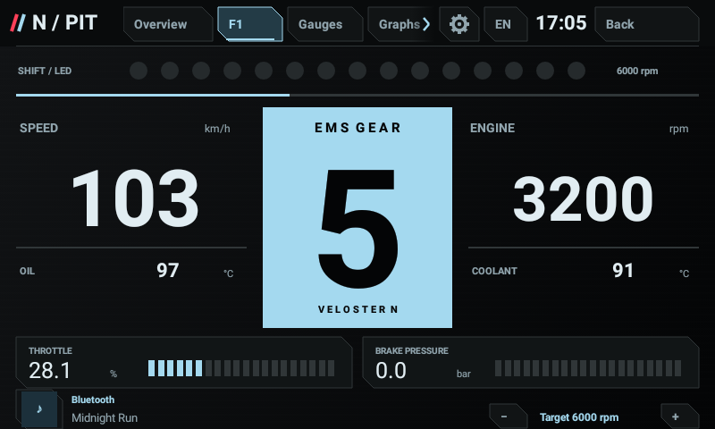<br><b>2. F1</b> · F1-style cluster</td></tr>
<tr><td width="50%" valign="top">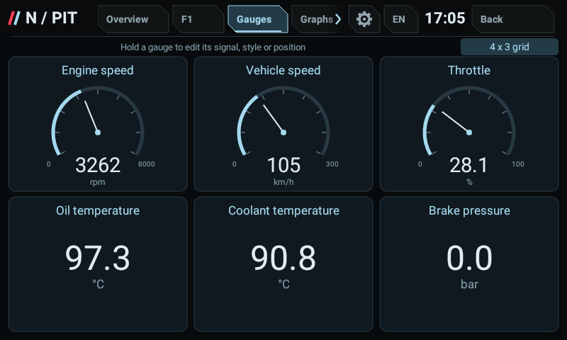<br><b>3. Gauges</b> · Your chosen gauges</td><td width="50%" valign="top">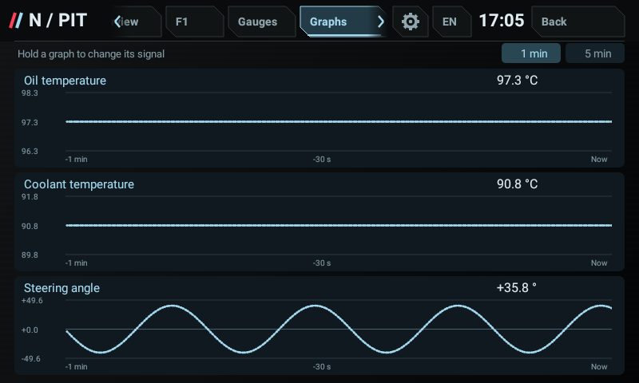<br><b>4. Graphs</b> · Values over time</td></tr>
<tr><td width="50%" valign="top">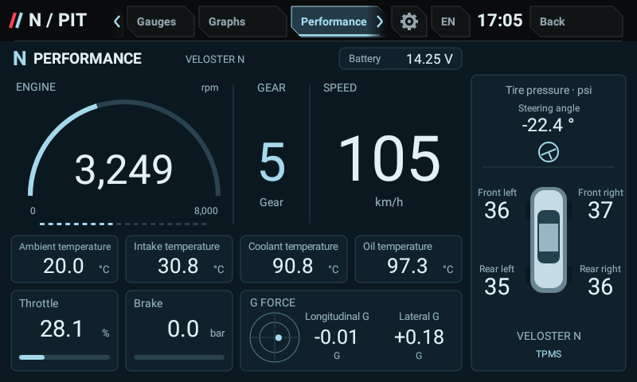<br><b>5. Performance</b> · N Performance screen</td><td width="50%" valign="top">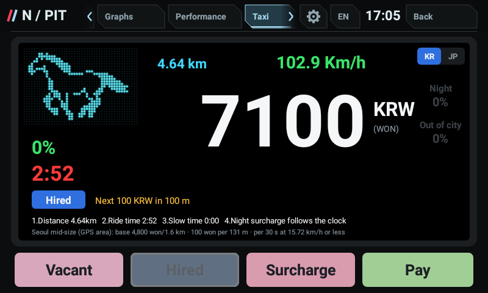<br><b>6. Taxi</b> · Taxi meter</td></tr>
<tr><td width="50%" valign="top">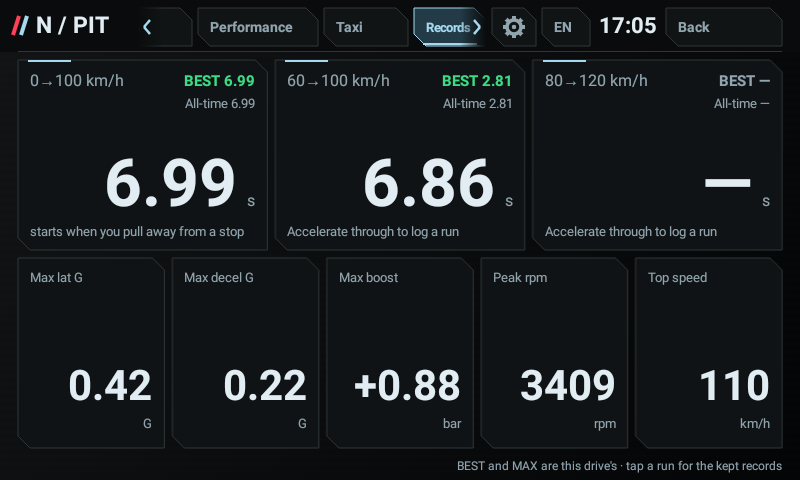<br><b>7. Records</b> · Acceleration runs and peaks</td><td width="50%" valign="top">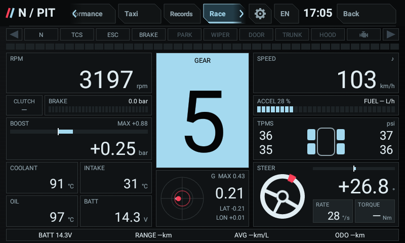<br><b>8. Race</b> · Shift lights · tyres · G-ball</td></tr>
<tr><td width="50%" valign="top">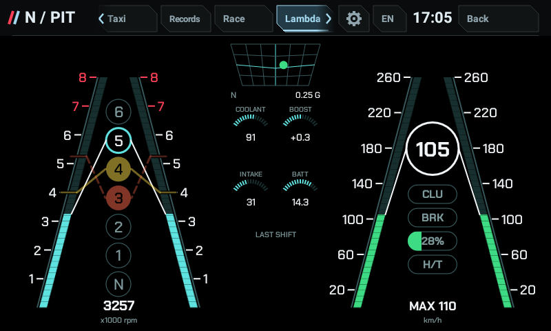<br><b>9. Lambda</b> · Λ rpm and speed</td><td width="50%" valign="top">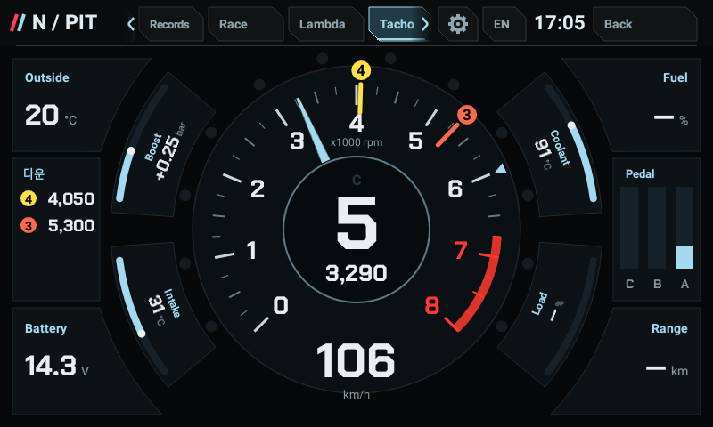<br><b>10. Tacho</b> · Round rpm · downshift</td></tr>
<tr><td width="50%" valign="top"><br><b>11. Neon Drive</b> · Pixel-art drive screen</td><td width="50%" valign="top">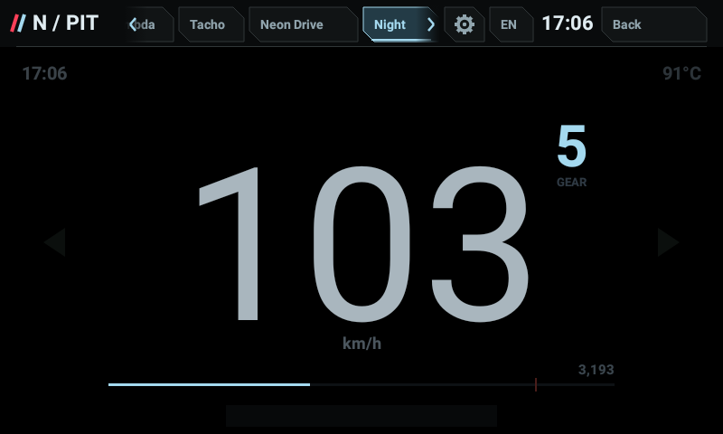<br><b>12. Night</b> · Night minimal</td></tr>
<tr><td width="50%" valign="top">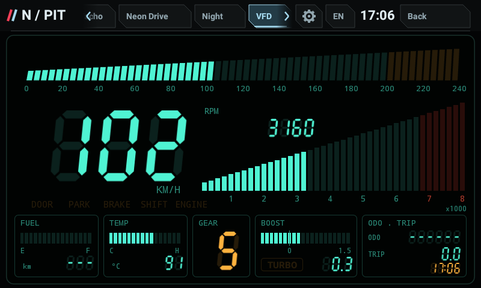<br><b>13. VFD</b> · 80s digital dash</td><td width="50%" valign="top">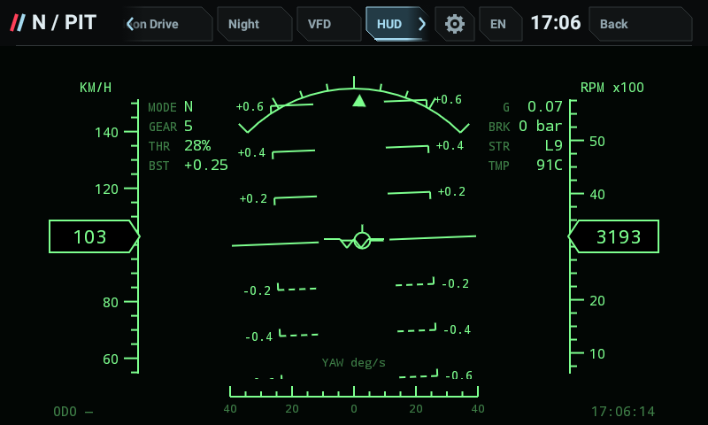<br><b>14. HUD</b> · Fighter HUD</td></tr>
<tr><td width="50%" valign="top">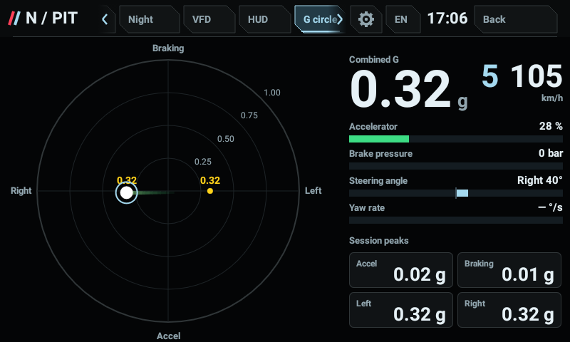<br><b>15. G circle</b> · Friction circle · G trail</td><td width="50%" valign="top">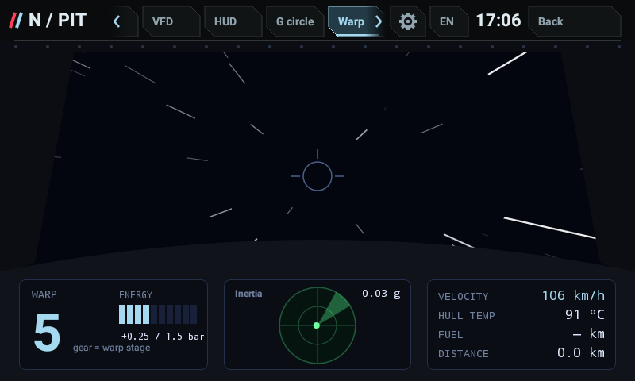<br><b>16. Warp</b> · Starship warp</td></tr>
<tr><td width="50%" valign="top">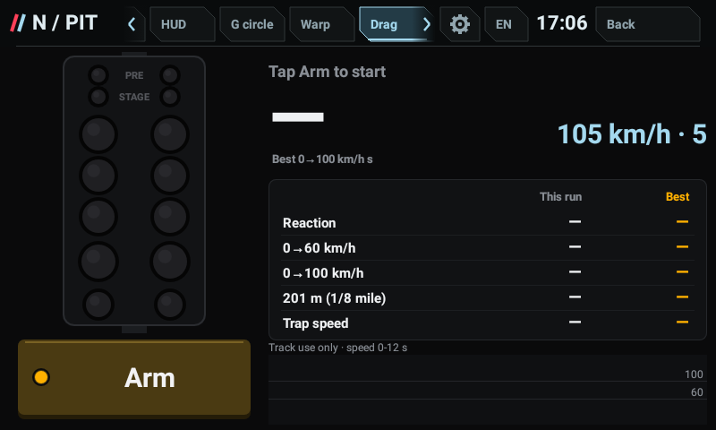<br><b>17. Drag</b> · Drag tree · 0-100</td><td width="50%" valign="top">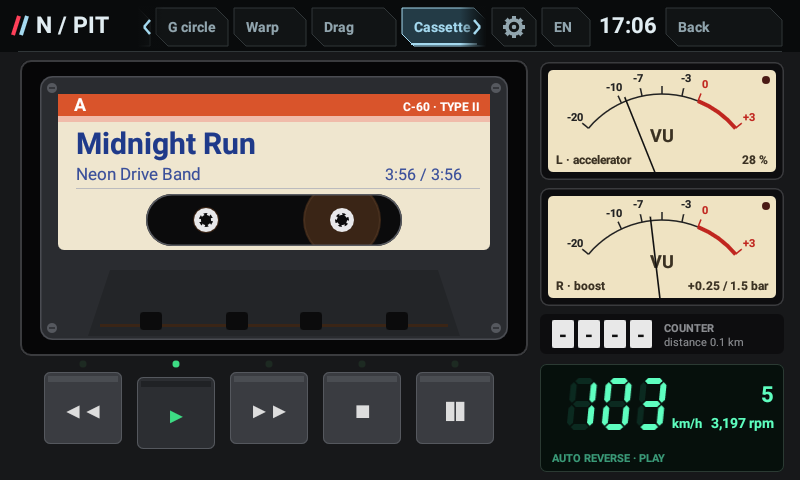<br><b>18. Cassette</b> · Cassette deck · VU meters</td></tr>
<tr><td width="50%" valign="top">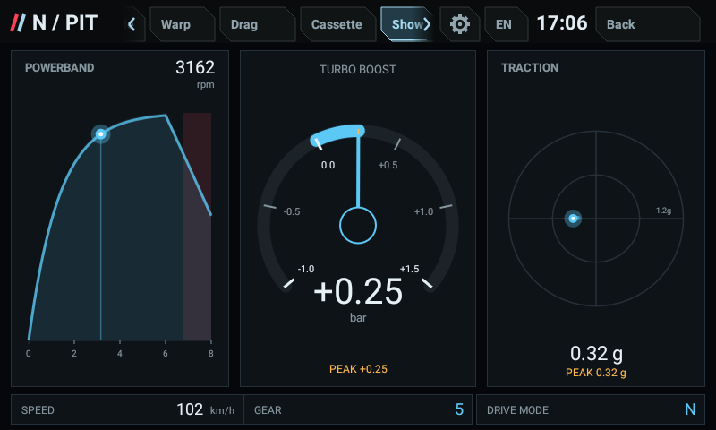<br><b>19. Show</b> · Powerband · boost · G circle</td><td width="50%" valign="top">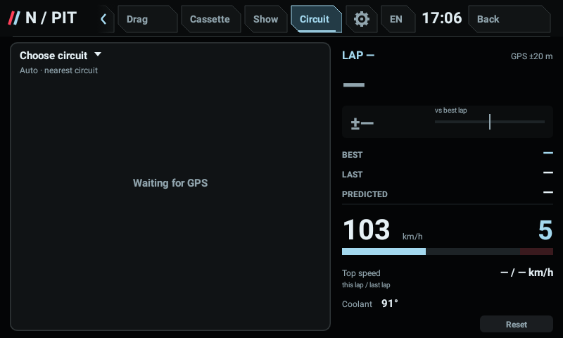<br><b>20. Circuit</b> · Circuit map · lap times</td></tr>
<tr><td width="50%" valign="top">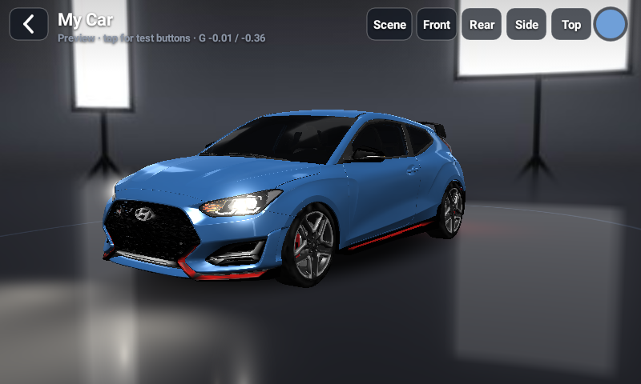<br><b>21. My Car</b> · 3D model with live lamps and steering</td><td width="50%" valign="top"></td></tr>
</table>

## Compatibility

The guarded installer supports **Korean Veloster N JSN**, product `jsn_kr`, **Android 4.2.2 / API 17**, incremental build `eng.vmadmin.20250902.081552` (`250902`, `STD_H`). The dashboard requires the factory `automotive` library. Other models, regions, firmware and ordinary Android devices are not validated.

**2026-11-25:** the Android installer on a tablet (USB OTG) installed N Dashboard v25 and My Apps v11 in the owner's car; the owner confirmed the ☆ button opening the dashboard and the purple N CUSTOM colour. Releases since (1.11.x: unified version, USB debugging in the dashboard, new screens) are tested on hosts and CI, not yet in the car. [Evidence and current status](docs/STATUS.md)

## Install

You need the car parked with the engine running, and one of: a Windows or macOS computer, a Linux PC or Raspberry Pi, or an Android phone or tablet with a USB OTG adapter. Every installer carries both apps, so the car needs no internet.

1. **Download** the installer for your device from the [latest release](https://github.com/reikop/veloster-n-dashboard/releases/latest):

   | Device | File | Run |
   | --- | --- | --- |
   | Windows | `vn-installer-windows.zip` | unzip, double-click `N계기판설치.cmd`, then **[설치]** in the window |
   | macOS | `vn-installer-mac.zip` | unzip, open `N 계기판 설치.app` (first time: System Settings → Privacy & Security → Open Anyway) |
   | Android phone or tablet | `vn-installer-android.apk` | install it, connect with a USB-C → USB-A OTG adapter and an A-A cable, tap **[설치]** |
   | Linux / Raspberry Pi | `vn-installer-linux.zip` | `unzip vn-installer-linux.zip -d vn && cd vn && bash install.sh` |

2. **Engineering mode** on the car: Settings → **SW 정보/업데이트**, tap the hidden area left of the update buttons **5 times**, then the right one **once**, within 10 seconds. Password: `0567` in 2026, `1278` in 2027.
3. **USB debugging**: Engineering mode → **Diagnosis → Factory Test**, send these three lines one at a time, pressing [SEND] after each:

   ```
   0A 01
   65 01
   0A 02
   ```

   If My Apps or N Dashboard 1.11.0+ is already installed, **My Apps → USB 디버깅 → ON** or **N Dashboard settings → 정보 → USB 디버깅 ON** does the same.
4. **Connect** the car's USB port to the computer (a data cable, not a charge-only one) and start the install. The installer checks it is a `jsn_kr` head unit on API 17 (another build number only shows a warning), installs both apps and opens My Apps on the car screen.
5. **USB debugging turns off** by itself when you restart the engine.

**Updates:** run the installer again; an app already at the same version is skipped. When a newer release is out, the Windows and macOS installers show an **[업데이트]** button that fetches the new installer (hash-checked) and opens it, the phone installer shows an update band, and the console installers ask.

Removing, diagnostics files and troubleshooting: [owner install guide (Korean)](INSTALL.md) · [ADB connection](docs/ADB_EN.md) · [installer details](installer/README.md)

## Documentation

| Guide | English | 한국어 |
| --- | --- | --- |
| 01 · Compatibility and verification | [Status](docs/STATUS.md) | [확인 범위](docs/STATUS.md#한국어) |
| 02 · ADB and USB connection | [ADB](docs/ADB_EN.md) | [ADB 연결](docs/ADB.md) |
| 03 · Install, update and recover | [Install](docs/INSTALL_EN.md) | [설치·복귀](docs/INSTALL.md) |
| 04 · My Apps and shortcuts | [My Apps](docs/MY_APPS.md) · [Quick entry](docs/QUICK_ENTRY.md) | [내 앱](docs/MY_APPS_ko.md) · [바로가기](docs/QUICK_ENTRY_ko.md) |
| 05 · Language settings | [Languages](docs/LANGUAGES.md) | [언어](docs/LANGUAGES.md#한국어) |
| 06 · Development and research | [Documentation index](docs/README.md#development-and-research) | [개발·연구 색인](docs/README.md#development-and-research) |

<a id="source-and-tests"></a>

## Development

[`apps/`](apps/) contains the two apps; [`shared/`](shared/) contains dashboard/UI/data code. [`compile-stubs/`](compile-stubs/) supplies build-only OEM declarations. [`scripts/`](scripts/) and [`tests/`](tests/) provide build, integrity and host checks. [`installer/`](installer/README.md) holds the owner installers (Windows, macOS, Linux).

[Build and test](docs/BUILD.md) · [Research walkthrough](docs/RESEARCH.md)

Project-authored code and documentation: [MIT](LICENSE). [Dependency and signing notices](NOTICE.md). The public AOSP test certificate is not a private publisher identity or an OTA key. Source builds are unsigned. OEM firmware/APKs, private logs, identifiers and signing keys are not distributed. Unofficial project; no manufacturer affiliation.
