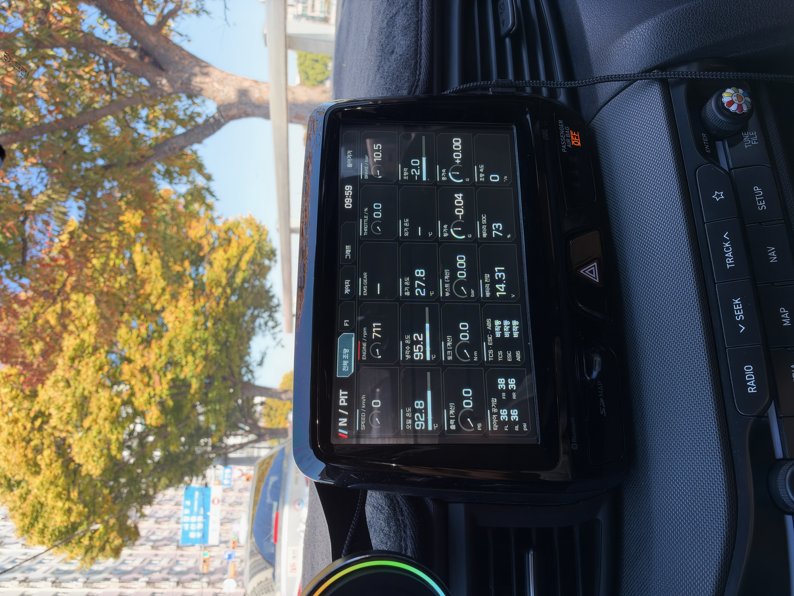

# Veloster N Dashboard — 독립 N 계기판

[English](README.md) | **한국어**

벨로스터 N 순정 내비게이션용 독립 계기판과 앱 실행 도우미 **‘내 앱’**입니다. 한국어·영어를 지원하며 순정 N 모드와 별도로 설치합니다.

[설치](#설치) · [호환성·확인 범위](docs/STATUS.md#한국어) · [문서](docs/README.md)



차주가 촬영한 실차 화면입니다. 수신하지 못한 값은 `-`로 표시합니다. 위치·촬영기기 메타데이터를 제거했으며 사진 픽셀은 변경하지 않았습니다.

## 기능

| N 계기판 | 내 앱 |
| --- | --- |
| 화면 20개: 전체 조망·F1·게이지·그래프·퍼포먼스·택시 미터기·기록·레이스·람다·타코·네온 드라이브·나이트·VFD·HUD·G 원·워프·드래그·카세트·쇼·서킷(국내 6곳 랩 타이머) | 계기판·설치 앱 실행 |
| 화면 목록(보이기·숨기기·순서)·테마 20종·길게 눌러 칸 바꾸기·주행 모드 색/화면 | 선택형 가장자리 버튼·알림 바로가기 |
| 다른 앱 위 플로팅 창·설정 백업·기록실(가속 측정 상위 기록 보관)·[내비 글꼴 바꾸기](docs/FONTS.md) | 엔지니어링 모드·USB 디버깅·Android 도구 |
| GPS로 고르는 17개 시·도 택시 요금·엔진 사운드·변속 알림음·과속 차임 | Bluetooth 페어링·확인창을 거치는 재시작 |
| RPM·속도·온도·TPMS·TCS/ESC/ABS·미디어 제어·앨범아트 | 앱 목록 편집·한국어/영어 선택 |

플로팅 창·설정 백업·기록실·테마·화면 목록·레이스/람다/타코·소리·택시 지역 요금·차주용 설치기는 i30 PD 포팅 [sung9155/i30-pd-dashboard](https://github.com/sung9155/i30-pd-dashboard)(MIT)에서 가져와 벨로스터 N에 맞췄습니다. 차주용 설치 안내: [INSTALL.md](INSTALL.md).

차량 데이터는 기존 수신 경로를 사용하며 ECU 진단 요청을 새로 보내지 않습니다. 미수신·만료 값은 알 수 없음으로 남깁니다. Bluetooth 앨범아트 수신·배기온·e-LSD는 미해결이며 무선 CarPlay·자동 업데이트는 구현하지 않았습니다. [상세 한계](docs/LIMITATIONS.md)

## 호환성

설치기 지원 대상은 **국내 벨로스터 N JSN**, product `jsn_kr`, **Android 4.2.2 / API 17**, incremental `eng.vmadmin.20250902.081552` (`250902`, `STD_H`)입니다. 계기판 실행에는 순정 `automotive` 라이브러리가 필요합니다. 다른 차종·지역·펌웨어·일반 Android 기기의 호환성은 확인하지 않았습니다.

**2026-11-25:** 태블릿(USB OTG)의 폰 설치 앱으로 차주 차에 N 계기판 v25·'내 앱' v11을 설치했고, ☆ 버튼 → 계기판과 N CUSTOM 보라색을 차주가 확인했습니다. 그 뒤 릴리스(1.11.x: 버전 통일, 계기판 USB 디버깅, 새 화면)는 호스트 시험과 CI로만 확인했고 실차는 아직입니다. [근거·현재 확인 범위](docs/STATUS.md#한국어)

## 설치

정차·시동 켠 상태에서 합니다. Windows·맥 컴퓨터, 리눅스 PC·라즈베리파이, 또는 OTG 어댑터를 쓸 수 있는 안드로이드 폰·태블릿 중 하나가 있으면 됩니다. 설치기마다 두 앱이 들어 있어 차에서 인터넷이 없어도 됩니다.

1. [최신 릴리스](https://github.com/reikop/veloster-n-dashboard/releases/latest)에서 기기에 맞는 설치기를 **받습니다**.

   | 기기 | 파일 | 실행 |
   | --- | --- | --- |
   | Windows | `vn-installer-windows.zip` | 압축을 풀고 `N계기판설치.cmd` 더블클릭 → 창에서 **[설치]** |
   | 맥 | `vn-installer-mac.zip` | 압축을 풀고 `N 계기판 설치.app` 실행(처음 한 번: 시스템 설정 → 개인정보 보호 및 보안 → [그래도 열기]) |
   | 안드로이드 폰·태블릿 | `vn-installer-android.apk` | 설치 후 OTG 어댑터(USB-C → USB-A 암) + A-A 케이블로 차에 연결, **[설치]** |
   | 리눅스·라즈베리파이 | `vn-installer-linux.zip` | `unzip vn-installer-linux.zip -d vn && cd vn && bash install.sh` |

2. 차에서 **엔지니어링 모드**: 설정 → **SW 정보/업데이트**에서 업데이트 버튼 줄의 왼쪽 숨은 영역을 **5번**, 오른쪽 숨은 영역을 **1번**, 10초 안에 누릅니다. 암호는 2026년 `0567`, 2027년 `1278`입니다.
3. **USB 디버깅 켜기**: 엔지니어링 모드 → **Diagnosis → Factory Test**에서 아래 세 줄을 한 줄씩 입력하고 매번 [SEND]를 누릅니다.

   ```
   0A 01
   65 01
   0A 02
   ```

   '내 앱'이나 N 계기판 1.11.0 이상이 이미 있으면 **'내 앱' → USB 디버깅 → ON** 또는 **N 계기판 설정 → 정보 → USB 디버깅 ON**으로 대신할 수 있습니다.
4. 차 USB 포트와 컴퓨터를 **연결**하고(충전 전용이 아닌 데이터 케이블) 설치를 시작합니다. 설치기가 `jsn_kr`·검증 빌드인지 확인한 뒤 두 앱을 설치하고 차 화면에 '내 앱'을 엽니다.
5. **USB 디버깅은 시동을 껐다 켜면 저절로 꺼집니다.**

**업데이트:** 설치기를 다시 실행하면 됩니다. 같은 버전이 깔린 앱은 건너뜁니다. 새 릴리스가 나오면 Windows·맥 창 설치기에 **[업데이트]** 단추가 떠서 새 설치기를 받아(해시 확인) 열어 주고, 폰 설치 앱은 업데이트 띠를, 콘솔 설치기는 받을지 묻습니다.

지우기, 진단 기록, 안 될 때: [차주용 설치 안내](INSTALL.md) · [ADB 연결](docs/ADB.md) · [설치기 자세히](installer/README.md)

## 문서

| 순서 | 한국어 | English |
| --- | --- | --- |
| 01 · 호환성·검증 | [확인 범위](docs/STATUS.md#한국어) | [Status](docs/STATUS.md) |
| 02 · ADB·USB 연결 | [ADB 연결](docs/ADB.md) | [ADB](docs/ADB_EN.md) |
| 03 · 설치·업데이트·복귀 | [설치](docs/INSTALL.md) | [Install](docs/INSTALL_EN.md) |
| 04 · 내 앱·바로가기 | [내 앱](docs/MY_APPS_ko.md) · [바로가기](docs/QUICK_ENTRY_ko.md) | [My Apps](docs/MY_APPS.md) · [Quick entry](docs/QUICK_ENTRY.md) |
| 05 · 언어 설정 | [언어](docs/LANGUAGES.md#한국어) | [Languages](docs/LANGUAGES.md) |
| 06 · 개발·연구 | [개발·연구 색인](docs/README.md#development-and-research) | [Documentation index](docs/README.md#development-and-research) |

## 개발

[`apps/`](apps/)는 두 앱, [`shared/`](shared/)는 계기판 UI·데이터 처리 소스입니다. [`compile-stubs/`](compile-stubs/)는 빌드 전용 OEM 선언이고, [`scripts/`](scripts/)·[`tests/`](tests/)는 빌드·무결성·호스트 검사 도구입니다. [`installer/`](installer/README.md)는 차주용 설치기(Windows·macOS·리눅스)입니다.

[빌드·테스트](docs/BUILD.md) · [개발 과정](docs/RESEARCH_ko.md)

자체 코드·문서는 [MIT](LICENSE)입니다. [의존성·서명 안내](NOTICE.md)를 참고하세요. 공개 AOSP 시험 인증서는 독점 배포자 신원이나 OTA 키가 아닙니다. 소스 빌드 결과는 서명 전 APK입니다. 제조사 펌웨어·APK, 개인 로그·식별자·개인키는 배포하지 않습니다. 제조사와 무관한 비공식 프로젝트입니다.
