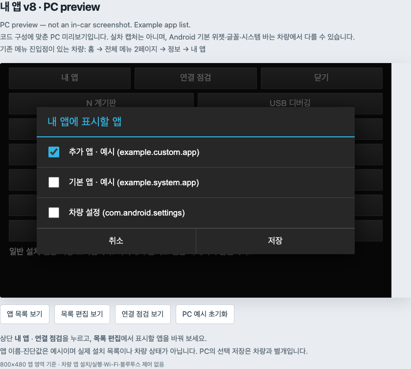
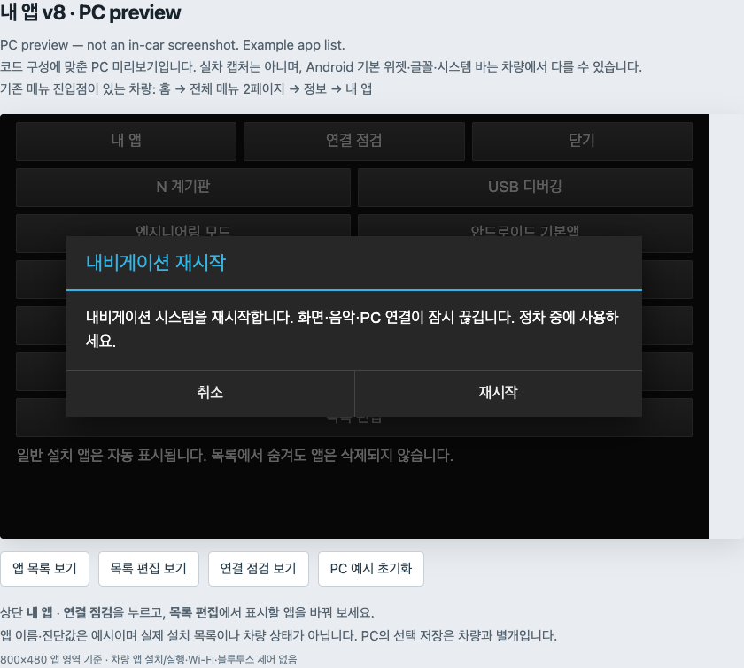
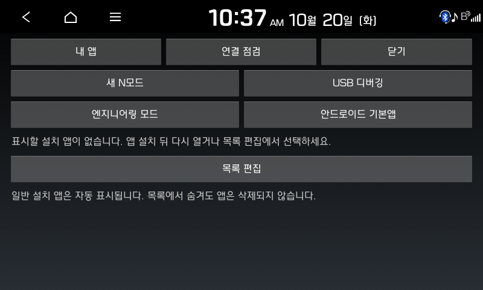

# 내 앱 — 앱 실행과 내비 설정 바로가기

한국어·영어 선택과 업데이트 변경점은 [언어 안내](LANGUAGES.md)를 참고하세요. 버튼 문구는 선택한 언어에 따라 표시됩니다.

[English](MY_APPS.md) | **한국어** | [프로젝트](../README_ko.md)

**내 앱**은 N 계기판·설치 앱·일부 내비 설정을 한곳에서 여는 별도 보조 앱입니다. 차량 값 수신 자체에 필요한 앱은 아니며 순정 홈을 교체하지 않습니다. 현재 사전 배포 버전은 **v10 / `1.9-i18n`**, 패키지는 `com.veloster.carplayhub`입니다. 초기 실험에서 남은 패키지 이름이며 무선 CarPlay 구현을 뜻하지 않습니다.

[내 앱 v10 다운로드](../apks/My-Apps-v10-API17.apk) · [설치 안내](INSTALL.md) · [실행 바로가기](QUICK_ENTRY_ko.md) · [재부팅 후 실행](INSTALL.md#after-reboot)

**v10는 서명·호스트 검사만 완료했으며 실차·에뮬레이터에서는 아직 시험하지 않았습니다.** 순정 메뉴 수정에 의존하지 않는 선택형 표준 Android 바로가기를 추가했지만, 모든 내비에서 동작한다는 뜻은 아닙니다.

## 화면 참고 — 이전 v8

**이전 v8 코드를 바탕으로 브라우저에서 만든 미리보기이며 현재 v10 화면이나 Android·실차 캡처가 아닙니다.** v10는 고정 버튼 위에 **실행 바로가기 / Quick entry**를 추가했습니다. 나머지 문구는 v8 소스에서 가져왔고 앱 이름은 예시입니다. 실제 Android 위젯·글꼴·시스템 바·설치 목록은 다를 수 있습니다. 문서 아래에는 이전 버전의 실제 차량 캡처도 실었습니다.

## 버튼별 기능

| 버튼 | 설명 |
| --- | --- |
| **실행 바로가기** | 가장자리 버튼 + 알림, 알림만, OFF를 선택합니다. 기본값은 OFF이며 명시적으로 켜 둔 바로가기만 부팅 후 복원을 요청합니다. |
| **내 앱** | 바로가기와 설치 앱 목록 화면으로 돌아갑니다. |
| **N 계기판** | 별도 설치한 `com.veloster.dashboard`를 실행합니다. 순정 N 모드 안의 예전 버튼에 의존하지 않습니다. |
| **USB 디버깅** | 요청된 OEM USB 상태를 표시하고 ON/OFF를 선택합니다. ON은 디버그 모드, OFF는 일반 USB 모드를 요청하며 ADB가 끊길 수 있습니다. 일반 Android 개발자 설정 토글과는 다릅니다. |
| **엔지니어링 모드** | 차량에 설치된 OEM 화면이 외부 실행을 허용할 때 엽니다. 없는 메뉴를 새로 만들지는 않습니다. |
| **안드로이드 기본앱** | 실행 가능한 설정·앱 관리·저장공간·개발자 설정 및 기본 앱을 엽니다. 기기별로 항목이 다를 수 있습니다. |
| **블루투스 연결 설정** | 기존 Android 스택을 사용하는 자체 Classic Bluetooth 검색·페어링 화면입니다. Android 기본 설정 앱을 가져온 것은 아닙니다. |
| **강제 재시작** | 확인창을 거쳐 내비 재시작을 요청합니다. 공장 초기화가 아니며 기기 권한에 따라 실패할 수 있습니다. |
| **목록 편집** | 실행 가능한 설치 앱 중 표시할 항목을 선택·저장합니다. 숨기는 것은 앱 삭제가 아닙니다. |
| **연결 점검** | 초기 무선 연구에서 사용한 상태 조회·시험 핫스팟 화면입니다. 평소 계기판 사용에는 필요하지 않으며 무선 CarPlay 기능이 아닙니다. |
| **닫기** | 내 앱을 닫고 이전 화면으로 돌아갑니다. |

## PC 없이 여는 방법

[설치·ADB 첫 실행](INSTALL.md) 후 **실행 바로가기 → 가장자리 버튼 + 알림 → 저장**을 선택합니다. HOME으로 돌아가 작은 **앱** 버튼으로 ‘내 앱’을 다시 열고 **N 계기판**을 누릅니다. 가장자리 버튼은 끌어서 위치를 옮길 수 있습니다. [자세한 바로가기 설정](QUICK_ENTRY_ko.md)을 참고하세요.

기본값은 OFF입니다. 켜 두면 v10가 부팅 후 바로가기 서비스 복원을 요청하지만 앱 화면을 자동으로 열지는 않습니다. 화면이 꺼지거나 잠기면 가장자리 버튼을 숨깁니다. 오버레이 표시가 차단되면 알림을 유지하지만 순정 UI에서 알림도 접근할 수 없을 수 있습니다. 강제 종료·시스템 정책이 복원을 막을 수 있으므로 실제 화면 재실행과 정차 상태의 별도 재부팅 확인이 필요합니다.

호환 런처를 사용해도 됩니다. 별도 OEM 메뉴를 수정한 연구 차량에서는 **홈 → 전체 메뉴 2페이지 → 정보 → 내 앱** 경로를 확인했습니다. 일반 APK만 설치해서 이 메뉴가 생기지는 않습니다. 표준 바로가기와 다른 런처 모두 사용할 수 없을 때 선택형 [OEM 메뉴 절차](MENU_ENTRY_ko.md)를 검토하며, 지원 원본이 일치하는 경우에만 적용합니다. 사용할 진입점이 없다면 [ADB 재실행](INSTALL.md#after-reboot)을 사용합니다. 앱을 실행한 뒤 계속 PC 케이블을 연결해 둘 필요는 없습니다.

## 앱 목록 편집하기

1. 사용할 호환 앱을 별도로 설치합니다. ‘내 앱’은 앱스토어나 다운로더가 아닙니다.
2. ‘내 앱’을 다시 엽니다. 실행 가능한 일반 앱은 이전에 숨기지 않았다면 자동으로 표시됩니다.
3. **목록 편집**에서 표시할 앱을 체크하거나 해제하고 **저장**을 누릅니다.
4. 목록의 앱 이름을 눌러 실행합니다. 선택은 로컬에 저장되어 다시 실행할 때 유지됩니다.

활성 상태이고 외부 실행이 허용되며 이 앱의 권한으로 실행 가능한 항목만 표시합니다. 실행 Activity가 없는 패키지는 나타나지 않을 수 있습니다. 편집에서 실행 가능한 시스템 앱을 골라도 새 권한을 부여하는 것은 아닙니다. N 계기판·엔지니어링 등의 고정 바로가기는 편집 목록과 별개입니다. 미리보기의 예시 앱은 배포 APK에 포함되지 않습니다.

## USB·블루투스·재시작 사용법

**USB 디버깅:** ON을 선택한 뒤 [ADB 연결 확인](ADB.md)을 따릅니다. 화면에 ON으로 표시되는 것과 PC에 USB 장치가 나타나는 것은 별개입니다. 이미 설치된 ‘내 앱’을 열 수 있어야 사용할 수 있으므로 최초 ADB 진입 수단은 아닙니다.

**블루투스:** 블루투스 연결 설정 → 주변 기기 검색 → 기기 선택 → 페어링 확인 순서입니다. 화면을 여는 것만으로 검색하거나 페어링하지 않습니다. 실제 GPS·오디오 연결에는 해당 앱과 지원 프로토콜이 필요합니다. BLE 검색과 XGPS160 데이터 수신은 구현하지 않았으므로 페어링만으로 활성화되지 않습니다.

**강제 재시작:** 버튼을 누른 뒤 확인창의 **재시작**을 명시적으로 누릅니다. 원하지 않으면 **취소**를 선택합니다. 실제 재시작은 화면·음악·PC 연결을 끊으므로 정차 중에 사용합니다. 지원하지 않는 기기에서는 권한 오류가 날 수 있습니다.

**연결 점검**에는 시험 핫스팟 켜기·접속정보 보기·기존 설정 복구가 남아 있습니다. 상태를 보는 것만으로 핫스팟이 켜지지는 않으며 변경·복구에는 명시적 조작이 필요합니다. 연구 차량에서는 Wi-Fi 활성화가 실패했습니다. 이 화면이나 `carplayhub`라는 이름을 무선 CarPlay 동작 확인으로 받아들이면 안 됩니다.

## 이전 버전의 실제 차량 캡처

**2026-10-20 실차 캡처**이며 현재 v10 화면은 아닙니다. 당시의 **새 N모드** 문구는 독립 **N 계기판** 바로가기 이전 이름이고, 이 캡처에는 블루투스·재시작 버튼이 아직 없습니다. 실제 위젯과 내비 시스템 바의 모습을 보여 주는 참고 자료입니다. 지도·기기 주소·개인 앱 목록이 보이지 않는 한 장만 선별했으며 세션 원본 로그는 공개하지 않습니다.

v8 미리보기는 2026-10-25 당시 공개 소스를 기준으로 만들었습니다. 설명은 2026-10-26 v10 기준으로 갱신했지만 이미지는 이전 v8 자료입니다. 이번 문서·v10 호스트 검증 중 새 차량 연결·설치·무선 조작·재부팅은 하지 않았습니다.
